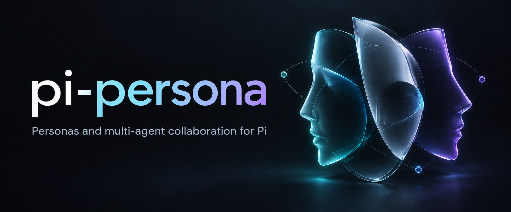
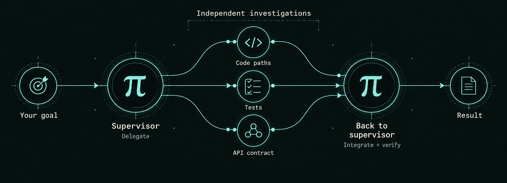
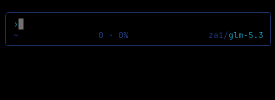

# pi-persona

<p align="center">
  
</p>

[](https://github.com/AeonDave/pi-persona/actions/workflows/test.yml) [](https://scorecard.dev/viewer/?uri=github.com/AeonDave/pi-persona) [](https://www.npmjs.com/package/@aeondave/pi-persona) [](LICENSE)

**Give Pi a supervised team.**
`pi-persona` adds async workers, live steering, cross-session collaboration and switchable
personas to Pi. Describe an outcome; a supervisor can delegate bounded work, gather results and
check the outcome while you inspect, redirect or stop workers.

[Install](#install) · [Team workflow](#work-with-your-team) · [Cross-session collaboration](#collaborate-with-another-pi) · [Personas](#choose-a-persona) · [Documentation](#documentation)

## Install

Requires **Pi 1.5.2** (the current stable target), **Node.js ≥ 22.19**, and **Git**. Configure a
model provider in Pi first. Update Pi with this extension; historical Pi versions are not maintained.

In your terminal:

```bash
pi install npm:@aeondave/pi-persona
pi
```

Inside Pi, install the bundled starting points and select a supervisor:

```text
/persona seed
/persona dev
```

Bundled personas are not installed automatically. Seed adds missing files without replacing your
customizations; see [Make it yours](#make-it-yours) before using restore.

| Option | Command |
|---|---|
| This project only | `pi install -l npm:@aeondave/pi-persona` |
| Pin this release | `pi install npm:@aeondave/pi-persona@1.18.0` |
| Pin the Git tag | `pi install git:github.com/AeonDave/pi-persona@v1.18.0` |
| Update an unpinned install | `pi update npm:@aeondave/pi-persona` |

Restart Pi after updating. Update pinned installs explicitly. When switching from Git to npm, remove
the exact Git source first (`pi remove git:github.com/AeonDave/pi-persona` for the unpinned source)
to avoid loading the extension twice.

## What it does

- **Coordinate work:** delegate independent investigations or edits; use councils and flows for
  alternative perspectives, review loops or staged work. Results return to the same supervisor.
- **Stay in control:** see live activity, steer a worker, retrieve retained results and stop runs.
- **Choose the approach:** switch personas and adapt worker roles, skills, models and thinking effort
  to the task rather than fixing a team size in advance.
- **Collaborate beyond one team:** Exocom connects independent Pi sessions to exchange findings and
  voluntarily coordinate work.
- **Watch for events:** timers, monitors and background scripts bring results back when ready.
- **Explore code:** use Pi's native search tools and bounded, multilingual source outlines.

## Work with your team

After seeding, start directly with `pi --persona dev` and describe the work in plain language:

> Fix the cancellation bug. Delegate independent investigations, preserve the public API,
> implement the fix, and run the relevant checks.



This is one possible workflow, not a fixed pipeline: independent questions can run in parallel,
while dependent steps run in order. For parallel edits, give writers disjoint repository-relative
`writeSet` paths. Ownership coordinates scheduling; it does **not** sandbox filesystem access.
Persona prose is not a security boundary: actual tool grants, runtime permissions and underlying
system permissions govern access. See [multi-agent quick start](docs/REFERENCE.md#multi-agent-quick-start).

In interactive sessions, delegate, council and flow runs start in the background. The supervisor can
continue independent work; once it is waiting, it should end its turn rather than poll or sleep.
Results arrive automatically when it is free. Headless `pi -p` waits and returns results inline.
Intercom can send guidance or retrieve a retained result (`intercom result { to: runId }`). A steering
receipt confirms a message was queued, not that the worker followed it; child-engine steering is a
follow-up rather than mid-turn injection. [Follow the work](docs/EXPERIENCE.md#follow-the-work-without-constant-polling).

| Control | Action |
|---|---|
| **F8** | Cycle installed personas |
| **F9** or `/agents` | Open the live panel; F9 closes it again |
| **Enter** / **s** / **x** / **X** | Inspect / steer / stop the selected controllable item / stop agents (confirm with a second press) |
| **Space** / **Left** / **Right** | Toggle / collapse / expand a group in F9 |
| `/peek` | Show a compact progress summary |
| `/flow` | List flows; `/flow <name> <task>` runs one, with approval at configured gates |
| `/persona list` / `/persona off` | List personas / turn off the active persona |
| `/persona-settings` / `/doctor` | Open settings / check configuration and capabilities |

F8 selects a persona immediately; its prompt applies at the next run, not inside an ongoing tool loop.
F9 groups workers, timers, monitors and scripts and shows Exocom peers read-only. Select a worker
for output, model, effort and cumulative usage. In alternate-screen mode, click group headings above
the editor to fold them; the fold state is shared with F9. Click a card or use Pi's configured expand
key (`Ctrl+O` by default) to see the full launch prompt, steering message or diagnostics. Ordinary
progress stays in the live view; stall and resume cards are operator-only. Periodic status cards are
optional and off by default.

Ask “remind me in ten minutes,” “let me know when this build finishes,” or “run the tests in the
background.” Timers schedule reminders, monitors watch events or process exits, and scripts run
commands or inline shell code with retained logs. Keep Pi open: running timers and monitors are not
restored after restart. See [timers, monitors and scripts](docs/MONITORS.md) for examples and limits.

Pi's native `grep`, `find` and `ls` are available to default supervisors and workers; Windows also
gets native PowerShell. Pi's own grants and exclusions remain authoritative, and Pi may download
missing `rg`/`fd` helpers on first use. `code_outline` reads declarations and line ranges from one
source file using a lazy local WASM parser: JavaScript/TypeScript, Python, Go, Rust, C-family and C#.
It is bounded, not a project index or compiler; C-family uses the C++ grammar and C# means source,
not .NET binaries. Unsupported files and syntax errors fail explicitly. See the
[outline reference](docs/REFERENCE.md#multilanguage-code-outline).

## Collaborate with another Pi

Intercom connects a supervisor to its workers. Exocom is a separate, opt-in plane between independent
Pi sessions. In two terminals in the same workspace, start each with:

```bash
pi --exocom --persona dev
```

Use `/exocom` to inspect the connection and workspace code. Peers can exchange messages, create
voluntary tasks and share bounded evidence excerpts; creating a task does not start work for a peer.
To join from another workspace, replace the example with the exact case-sensitive code shown:

```bash
pi --exocom=Ab0T --persona researcher
```

Sessions must share a machine and Pi agent directory. A foreign-workspace peer can advise, exchange
results and take read-only tasks, but cannot claim or take tasks declaring write paths in the joined
workspace. See the [collaboration guide](docs/COLLABORATION.md) for asks, offers and task workflows.

## Choose a persona

Personas shape the supervisor's approach and orchestration defaults. Start with `dev` for code,
`multiagent` for mixed work, or `reverser` for artifact-led binary and project analysis.



`reverser` discovers installed skills, integrated appskills and tools, follows their workflows, and
orients on the artifact before delegating bounded questions. `multiagent` coordinates research,
code, documentation and troubleshooting without requiring a fixed fan-out. Both select models
and supported thinking effort for each task within the current provider, respecting explicit user
choices. With an aggregator, their prompt guidance favors a few useful workers on the supervisor's
exact model instead of a catalog sweep. Availability and effective effort depend on the host; this
is guidance, not a runtime provider lock. `dev` also follows task-fit selection.

Browse the bundled [personas](personas) and [worker agents](agents), or use the
[practical guide](docs/EXPERIENCE.md) to choose a workflow. Councils can use strategies such as
`judge`, `magi` or `debate` independently of the active persona. In councils and flows, a provider
failure or unavailable model can recover once on the supervisor's model; ordinary delegate provider
pins remain strict. See [strategies](docs/STRATEGIES.md) and the [reference](docs/REFERENCE.md).

## Make it yours

Edit installed personas and agents in `~/.pi/agent/persona/agents/`, or add project overrides in
`.pi/agents/`. Run `/persona reload` to refresh definitions after editing.

**`/persona seed` adds missing defaults and preserves existing files.** **`/persona restore` overwrites
bundled defaults**, including customized files at those destinations. Additional custom files,
settings, credentials, sessions and project-local overrides are not reset. Compare your edits before
restoring.

`/persona-settings` manages Persona preferences and model assignments, separately from Pi's
`/settings`. Scalar changes apply after restarting Pi or Pi's native `/reload`, not `/new`;
`/persona reload` refreshes resources only. Model changes apply to future runs. Idle compaction
remains unavailable pending host qualification; see [configuration and settings](docs/REFERENCE.md#configuration-and-data).

## Optional memory companion

[pi-persona-mind 0.9.0](https://github.com/AeonDave/pi-persona-mind/releases/tag/v0.9.0) adds
project/persona memory, session notes, an F10 inspector, consolidation and evidence-grounded review.
Install it with
`pi install npm:@aeondave/pi-persona-mind`, then restart Pi or use `/reload`. Its
[README](https://github.com/AeonDave/pi-persona-mind#readme) covers scope, review limits and undo.
Loaded compatible Mind and Flow companions can contribute settings to Persona's panel; Skill Optimizer
keeps its own configuration. See [companion settings](docs/REFERENCE.md#configuration-and-data).

## Documentation

- [Everyday use](docs/EXPERIENCE.md) · [Cross-session collaboration](docs/COLLABORATION.md)
- [Customization and tool reference](docs/REFERENCE.md) · [Strategies and flows](docs/STRATEGIES.md)
- [Timers, monitors and scripts](docs/MONITORS.md) · [Architecture](docs/ARCHITECTURE.md)
- [Shared prompts](docs/SPINE.md) · [Telemetry](docs/TELEMETRY.md) · [Changelog](CHANGELOG.md)

## Develop

From a checkout:

```bash
npm ci
npm run typecheck
npm test
```

Native search integration tests require real `rg` and `fd` on `PATH`; CI prepares them with Pi's
downloader before offline tests. See [AGENTS.md](AGENTS.md) for isolated preparation.

Pi loads the TypeScript extension directly; there is no build step. See [AGENTS.md](AGENTS.md) for
contribution conventions, the [architecture](docs/ARCHITECTURE.md#module-layout) for module boundaries,
and the [security policy](SECURITY.md) for private vulnerability reporting. Licensed under [MIT](LICENSE).
