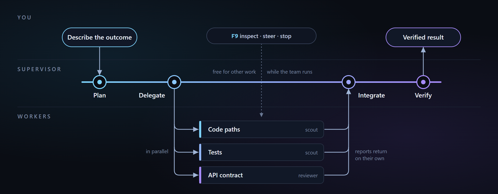
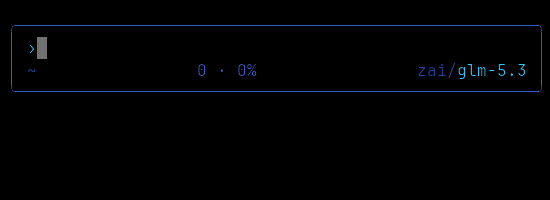

# pi-persona

<p align="center">
  
</p>

[](https://github.com/AeonDave/pi-persona/actions/workflows/test.yml) [](https://scorecard.dev/viewer/?uri=github.com/AeonDave/pi-persona) [](https://www.npmjs.com/package/@aeondave/pi-persona) [](LICENSE)

**Give Pi a supervised team.**
Delegate focused work. Steer it live. Keep the whole team in view.

`pi-persona` adds async workers, switchable personas and collaboration between independent Pi
sessions. Describe an outcome; the supervisor can split the work, gather results and check them.
You can inspect, redirect or stop workers throughout.

[Install](#install) · [Team workflow](#work-with-your-team) · [Explore source code](#explore-source-code) · [Cross-session collaboration](#collaborate-with-another-pi) · [Personas](#choose-a-persona) · [Documentation](#documentation)

## Install

Requires **Pi 1.5.2** (the current stable target), **Node.js ≥ 22.19**, and **Git**. Configure a
model provider in Pi first. Update Pi with this extension; historical Pi versions are not maintained.

In your terminal:

```bash
pi install npm:@aeondave/pi-persona
```

Inside Pi, install the bundled starting points and select a supervisor:

```text
/persona seed
/persona dev
```

Seed installs the bundled starting points without replacing your customizations.

| Option | Command |
|---|---|
| This project only | `pi install -l npm:@aeondave/pi-persona` |
| Pin this release | `pi install npm:@aeondave/pi-persona@1.18.1` |
| Pin the Git tag | `pi install git:github.com/AeonDave/pi-persona@v1.18.1` |
| Update an unpinned install | `pi update npm:@aeondave/pi-persona` |

Restart Pi after updating. Update pinned installs explicitly. When switching from Git to npm, remove
the exact Git source first (`pi remove git:github.com/AeonDave/pi-persona` for the unpinned source)
to avoid loading the extension twice.

## What it does

| Capability | What you get |
|---|---|
| **A team for the task** | Parallel workers, councils for independent perspectives, and flows for staged work and approval gates. |
| **Focused specialists** | Choose each worker's role, skills, model and effort. Selected skill instructions load before its first model request. |
| **Live supervision** | F9 brings workers, timers, monitors and scripts into one view. Inspect output, steer work and stop runs. |
| **Continuity** | Continue saved worker conversations; restore a compact view of pending work, asks and result references after Pi compacts context. |
| **Pi-to-Pi collaboration** | Exocom lets independent sessions exchange findings, offer tasks and coordinate ownership. |
| **Useful local tools** | Multilingual code outlines, native search, background scripts, event monitors and terminal image previews. |

Tool permissions remain separate from prompts and skill selection. See the
[tool and configuration reference](docs/REFERENCE.md) for the exact contracts.

## Work with your team

After seeding, start directly with `pi --persona dev` and describe the work in plain language:

> Fix the cancellation bug. Delegate independent investigations, preserve the public API,
> implement the fix, and run the relevant checks.



Independent questions can run in parallel; dependent steps run in order. Parallel writers declare
disjoint `writeSet` paths. Optional Git worktrees require a clean checkout, isolate edits and return a
diff for review.
Write sets coordinate ownership; they do **not** sandbox filesystem access.
[Multi-agent quick start →](docs/REFERENCE.md#multi-agent-quick-start)

Interactive runs work in the background and return results automatically when the supervisor is
free. It can do other work, then end its turn while waiting. Headless `pi -p` returns results inline.
[Follow the work →](docs/EXPERIENCE.md#follow-the-work-without-constant-polling)

Need a follow-up from the same specialist? When its conversation was saved successfully:

```text
delegate { resume: "run-1", task: "Check the remaining edge case" }
```

Use `intercom { action: "conversations" }` to find the latest available run ID. Saved transcripts
can contain full prompts and tool results; see [continuation and storage](docs/REFERENCE.md#continuing-a-worker-conversation)
for availability, limits and cleanup.

| Control | Action |
|---|---|
| **F8** | Cycle installed personas |
| **F9** or `/agents` | Inspect and control live work; F9 closes the panel |
| Click a card / **Ctrl+O** | Expand prompts, messages and diagnostics using Pi's configured expand binding |
| `/peek` | Show a compact progress summary |
| `/flow` | List flows; `/flow <name> <task>` runs one, with approval at configured gates |
| `/persona-settings` / `/doctor` | Open settings / check configuration and capabilities |

F9 shows each worker's output, model, effort and cumulative usage, plus a read-only Exocom peer
section. Fold groups in the panel or click their headings above the editor in alternate-screen mode.
Ordinary progress stays in the live view; stall and resume cards draw attention when needed.
F9 and Mind's F10 share the same responsive window frame.

Ask “remind me in ten minutes,” “let me know when this build finishes,” or “run the tests in the
background.” Timers, monitors and scripts share that view, with retained process logs. Keep Pi
open: these running resources are session-scoped. [Examples and controls →](docs/MONITORS.md)

## Explore source code

Find files and text with Pi's native `grep`, `find` and `ls`; Windows also gets native PowerShell.
Use **`code_outline`** to find declarations and line ranges before reading a source file. Given:

```ts
export class Cart {
  total() { return 0; }
}
```

`code_outline({ path: "src/cart.ts" })` returns rows like:

```text
"Cart" [class] L1-3
"total" [method] in "Cart" L2-2
```

Narrow a large file by searching a literal name, kind or container, then pass the returned line range
to Pi's `read` tool:

```text
code_outline({ path: "src/cart.ts", query: "total" })
read({ path: "src/cart.ts", offset: 2, limit: 1 })
```

Supports **JavaScript/TypeScript, Python, Go, Rust, C-family and C# source**, using one local,
on-demand WASM parser. No server or persistent index. Unsupported files and syntax errors fail
explicitly. See [supported syntax and limits](docs/REFERENCE.md#multilanguage-code-outline), including
the C-family grammar boundary, and [native search setup](docs/REFERENCE.md#native-ossearch-tools).

## Display an image

Use `show_image({ path: "assets/diagram.png" })` to show a local PNG, JPEG, GIF or WebP to the
user. Pi's Kitty or iTerm2 graphics are used when available; otherwise it shows ANSI color cells or
plain ASCII, without external image programs. Use Pi's `read` tool for model image analysis.
[Formats, display modes and limits →](docs/REFERENCE.md#terminal-image-preview)

## Collaborate with another Pi

Intercom connects a supervisor to its workers. Exocom is a separate, opt-in plane between independent
Pi sessions. In two terminals in the same workspace, start each with:

```bash
pi --exocom --persona dev
```

Use `/exocom status` to inspect the connection and workspace code, or `/exocom help` for usage. Then try:

```text
Pi A: Name yourself Ember for this session and list your Exocom peers.
Pi B: Name yourself Flint, list your Exocom peers, and send Ember: Hello from Pi B.
```

Pi A receives the message automatically. Peers can also ask questions, offer voluntary tasks and
share evidence; creating a task does not start another session's work.

To join from another workspace, use the exact code shown, for example `pi --exocom=Ab0T`.
Sessions must share a machine and Pi agent directory; foreign-workspace participation has narrower
write-coordination permissions. [First exchange, task workflows and delivery guarantees →](docs/COLLABORATION.md)

## Choose a persona

Personas shape the supervisor's approach and orchestration defaults. Start with `dev` for code,
`multiagent` for mixed work, or `reverser` for artifact-led binary and project analysis.



F8 cycles installed personas; `/persona <name>` selects one and `/persona off` turns it off. A new
persona's prompt applies on the next run. Browse the bundled [personas](personas) and
[worker agents](agents), or use the [practical guide](docs/EXPERIENCE.md) to choose a workflow.

Councils can use `judge`, `magi`, `debate` and other strategies independently of the active persona.
[Strategies and flows →](docs/STRATEGIES.md)

## Make it yours

Edit installed personas and agents in `~/.pi/agent/persona/agents/`, or add project overrides in
`.pi/agents/`. Run `/persona reload` to refresh definitions after editing.

**`/persona seed` adds missing defaults and preserves existing files.** **`/persona restore` overwrites
bundled defaults**, including customized files at those destinations. Additional custom files,
settings, credentials, sessions and project-local overrides are not reset. Compare your edits before
restoring.

`/persona-settings` manages Persona preferences and model assignments. Scalar changes apply after
restarting Pi or Pi's native `/reload`; model changes apply to future runs.
[Configuration, settings and companion integration →](docs/REFERENCE.md#configuration-and-data)

## Optional memory companion

[pi-persona-mind](https://github.com/AeonDave/pi-persona-mind) adds
project/persona memory, session notes, an F10 inspector, consolidation and evidence-grounded review.
Install it with
`pi install npm:@aeondave/pi-persona-mind`, then restart Pi or use `/reload`. Its
[README](https://github.com/AeonDave/pi-persona-mind#readme) covers scope, review limits and undo.

## Documentation

| You want to… | Read |
|---|---|
| Choose a workflow and supervise it | [Everyday use](docs/EXPERIENCE.md) |
| Connect independent Pi sessions | [Collaboration](docs/COLLABORATION.md) |
| Configure tools, permissions and storage | [Reference](docs/REFERENCE.md) |
| Build councils, review loops and staged work | [Strategies and flows](docs/STRATEGIES.md) |
| Schedule reminders and run background jobs | [Timers, monitors and scripts](docs/MONITORS.md) |
| Understand implementation contracts | [Architecture](docs/ARCHITECTURE.md) · [Shared prompts](docs/SPINE.md) · [Telemetry](docs/TELEMETRY.md) |

The README follows the current checkout. See the [changelog](CHANGELOG.md) for release availability
and the [documentation index](docs/README.md) for review records.

## Develop

From a checkout:

```bash
npm ci
npm run typecheck
npm test
```

Native search integration tests require real `rg` and `fd` on `PATH`; CI prepares them with Pi's
downloader before offline tests. See [AGENTS.md](AGENTS.md) for isolated preparation.

Pi loads the TypeScript extension directly; there is no build step. See [AGENTS.md](AGENTS.md) for
contribution conventions, the [architecture](docs/ARCHITECTURE.md#module-layout) for module boundaries,
and the [security policy](SECURITY.md) for private vulnerability reporting. Licensed under [MIT](LICENSE).
