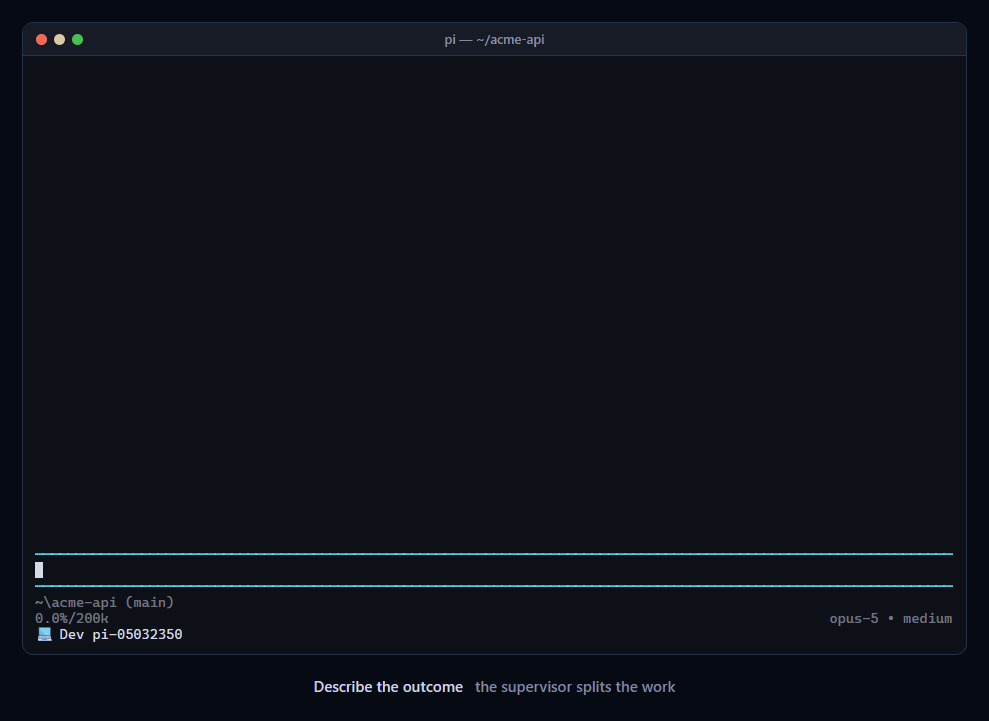
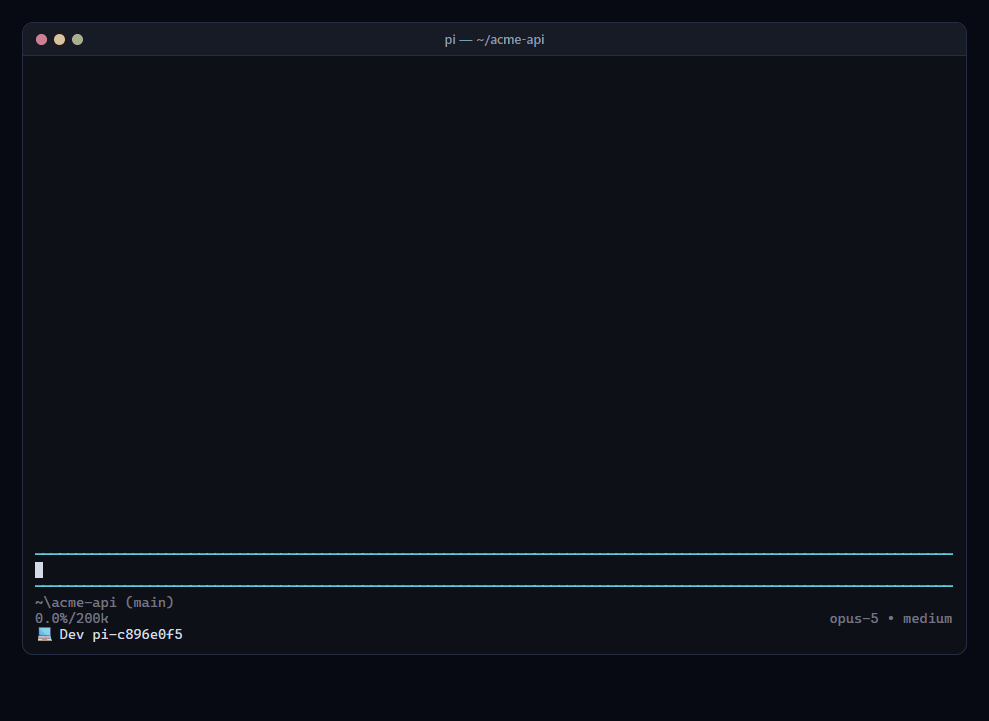
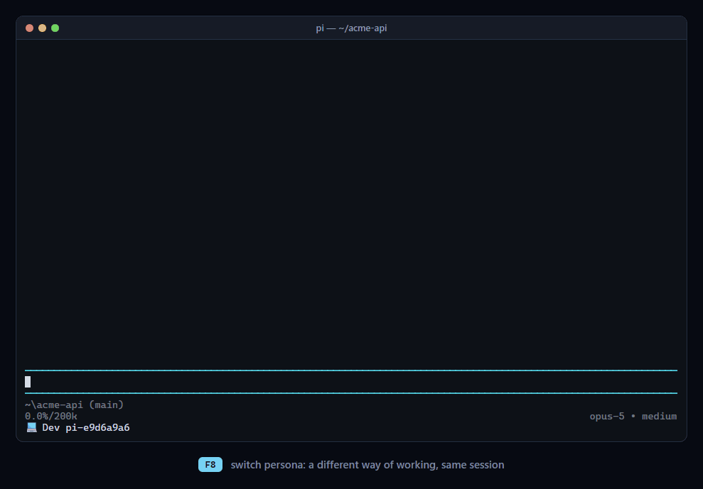
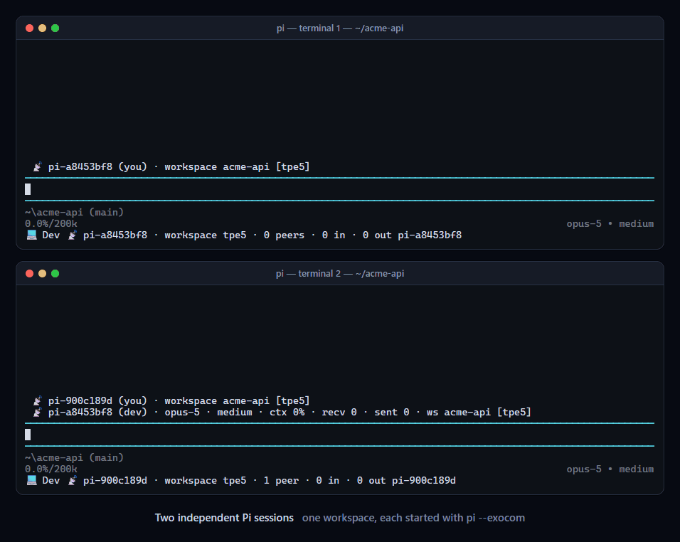
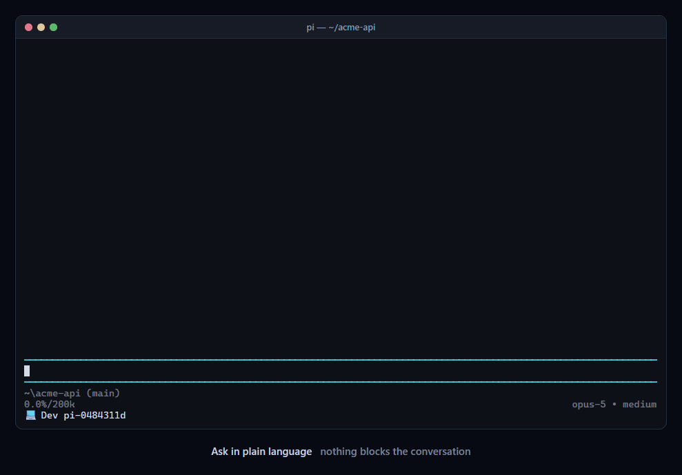

<p align="center">
  
</p>

<h3 align="center">Give Pi a supervised team.</h3>

<p align="center">
  <b>The most advanced supervisor system for Pi.</b><br>
  Delegate focused work. Steer it live. Keep the whole team in view.
</p>

<p align="center">
  <a href="https://github.com/AeonDave/pi-persona/actions/workflows/test.yml"></a>
  <a href="https://scorecard.dev/viewer/?uri=github.com/AeonDave/pi-persona"></a>
  <a href="https://www.npmjs.com/package/@aeondave/pi-persona"></a>
  <a href="LICENSE"></a>
</p>

<p align="center">
  <a href="#quick-start">Quick start</a> ·
  <a href="#see-it-work">See it work</a> ·
  <a href="#features">Features</a> ·
  <a href="#personas">Personas</a> ·
  <a href="#documentation">Documentation</a>
</p>



`pi-persona` is an extension for the Pi coding agent. Describe an outcome: the
supervisor splits the work across parallel workers, collects their reports and checks the result.
You watch every worker live, and can read, redirect or stop any of them at any moment.

## Quick start

Requires **Pi 1.6.0**, **Node.js ≥ 22.19** and **Git**, with a model
provider already configured in Pi.

```bash
pi install npm:@aeondave/pi-persona
```

Inside Pi, install the bundled personas and agents, then pick a supervisor:

```text
/persona seed
/persona dev
```

Now describe the work in plain language:

> Fix the cancellation bug. Delegate independent investigations, preserve the public API,
> implement the fix, and run the relevant checks.

Later sessions can start directly with `pi --persona dev`. Seeding never replaces your customizations.

<details>
<summary>Project-only installs, version pins and updates</summary>

| Option | Command |
|---|---|
| This project only | `pi install -l npm:@aeondave/pi-persona` |
| Pin this release | `pi install npm:@aeondave/pi-persona@1.20.1` |
| Pin the Git tag | `pi install git:github.com/AeonDave/pi-persona@v1.20.1` |
| Update an unpinned install | `pi update npm:@aeondave/pi-persona` |

Restart Pi after updating. Update pinned installs explicitly. When switching from Git to npm, remove
the exact Git source first (`pi remove git:github.com/AeonDave/pi-persona` for the unpinned source)
to avoid loading the extension twice. Historical Pi versions are not maintained: update Pi together
with this extension.

</details>

## See it work

### Supervise every worker, live

Press **F9** to see the whole team. Open a worker to read its conversation and tool calls as they
happen, press `s` to send it a new instruction mid-run, or `x` to stop the one you no longer need.



[Reading and messaging workers →](docs/REFERENCE.md#reading-and-messaging-workers)

### Decide with a council

Press **F8** to switch persona. Under MAGI, three cores with opposed biases vote on a real fork, each
on the model you assign it. The majority decides and the dissent is kept as a minority report.



[Strategies and flows →](docs/STRATEGIES.md)

### Collaborate across sessions

Start two Pi sessions in the same workspace with `pi --exocom` and they find each other: no server,
no setup. Messages arrive on their own, so one session can hand a review to another and keep working.



[Collaboration guide →](docs/COLLABORATION.md)

### Keep work in the background

Ask for a background build, a watch on a deploy or a reminder in plain language. Scripts, event
monitors and timers sit in the same F9 view as your workers, and each one wakes the supervisor
when it has news.



[Timers, monitors and scripts →](docs/MONITORS.md)

<sub>The recordings show the real Pi interface running this extension. Model replies are scripted so
that they are reproducible and cost nothing: see [`scripts/demo`](scripts/demo/record.mjs).</sub>

## Features

| Feature | What you can do |
|---|---|
| **[Parallel workers](docs/REFERENCE.md#multi-agent-quick-start)** | Split a task across workers and receive their results automatically while you keep working. |
| **[Focused specialists](docs/REFERENCE.md#core-api)** | Choose each worker's role, tools, skills, model and effort. |
| **[Live supervision](docs/REFERENCE.md#reading-and-messaging-workers)** | Open F9 to read searchable worker chats, inspect tool calls, send instructions and stop runs. |
| **[Switchable personas](#personas)** | Change the supervisor's approach with F8, using bundled personas or your own. |
| **[Reviews and staged work](docs/STRATEGIES.md)** | Gather independent perspectives, compare proposals, or run flows with approval gates. |
| **[Pi-to-Pi collaboration](docs/COLLABORATION.md)** | Let independent sessions exchange findings, offer tasks and coordinate file ownership through Exocom. |
| **[Conversation continuity](docs/REFERENCE.md#continuing-a-worker-conversation)** | Continue a successfully saved worker conversation with a follow-up task. |
| **[Reviewable changes](docs/REFERENCE.md#verifying-isolated-changes)** | Isolate edits in Git worktrees, run verification commands and inspect the resulting diffs and check outcomes. |
| **[Structured findings](docs/REFERENCE.md#structured-results)** | Collect findings with file, line, severity and evidence; validate their structure or define your own format. |
| **[Code navigation](#explore-source-code)** | Find files and text, then extract functions, classes and line ranges without reading entire source files. |
| **[Background jobs and reminders](docs/MONITORS.md)** | Run scripts asynchronously, watch for events and schedule reminders, with logs and controls in F9. |
| **[Terminal images](#display-an-image)** | View local images using native terminal graphics, ANSI color or plain ASCII, with click-to-enlarge previews. |

The **[full reference](docs/REFERENCE.md)** covers every tool, command, permission and setting.
Optional project memory comes from [pi-persona-mind](#optional-memory-companion).

## How a run works


- **Parallel where it is safe.** Independent questions run in parallel; dependent steps run in
  order. Parallel writers declare disjoint `writeSet` paths, which coordinate ownership but do
  **not** sandbox filesystem access. [Multi-agent quick start →](docs/REFERENCE.md#multi-agent-quick-start)
- **No polling.** Interactive runs work in the background and report back when the supervisor is
  free. Headless `pi -p` returns results inline.
  [Follow the work →](docs/EXPERIENCE.md#follow-the-work-without-constant-polling)
- **Changes you can review.** Optional Git worktrees need a clean checkout, isolate the edits and
  return a diff. Attach a `verification` command such as `npm test`: its exit status and output are
  recorded before the diff is exported, and a failed check keeps the worktree for recovery.
  [Verification and recovery →](docs/REFERENCE.md#verifying-isolated-changes)
- **Follow-ups keep their context.** Continue a saved worker conversation with
  `delegate { resume: "run-1", task: "Check the remaining edge case" }`;
  `intercom { action: "conversations" }` lists what is available.
  [Continuation, storage and cleanup →](docs/REFERENCE.md#continuing-a-worker-conversation)
- **Jobs and reminders in the same view.** Ask “remind me in ten minutes,” “let me know when this
  build finishes,” or “run the tests in the background.” Timers, monitors and scripts appear in F9
  with their logs. They are session-scoped, so keep Pi open. [Examples and controls →](docs/MONITORS.md)

### Controls

| Control | Action |
|---|---|
| **F8** | Cycle installed personas |
| **F9** or `/agents` | Inspect and control live work; F9 closes the panel |
| **Enter** on a worker | Open its scrollable chat; `/` searches, `s` steers, `x` stops |
| `/agents send <name> <message>` | Message a running worker directly; autocomplete supplies unambiguous run IDs |
| Click a card / **Ctrl+O** | Expand prompts, messages and diagnostics using Pi's configured expand binding |
| `/peek` | Show a compact progress summary |
| `/flow` | List flows; `/flow <name> <task>` runs one, with approval at configured gates |
| `/persona-settings` / `/doctor` | Open settings / check configuration and capabilities |

Recent workers stay readable while retained. Ordinary progress stays in the live view; stall and
resume notices draw attention when needed.
[Chat controls →](docs/REFERENCE.md#reading-and-messaging-workers) · [Retention and cleanup →](docs/REFERENCE.md#data-retention-and-cleanup)

## Personas

A persona shapes how the supervisor works and which orchestration it reaches for. **F8** cycles the
installed ones, `/persona <name>` selects one and `/persona off` turns it off. A new persona's prompt
applies on the next run.

| Persona | Pick it when |
|---|---|
| 💻 **dev** | The deliverable is a working change: tests first, heavy work handed off, every claim proved by a fresh check. |
| 🧭 **multiagent** | Mixed research, code, docs or troubleshooting needs coordinated independent perspectives. |
| 🗺️ **planner** | You want a bounded, verifiable plan or design document before building. |
| 🔬 **audit** | A change needs review through correctness, security, performance and test lenses. |
| ✅ **verify** | “Done” must mean proven by a real build and test run. |
| 🧠 **magi** | A contested choice between real alternatives deserves a three-core vote with dissent kept. |
| 🏛️ **judge** | Rival complete answers need an impartial pick from an anonymised ballot. |
| 🐝 **swarm** | One operation repeats over many independent items. |
| 📚 **researcher** | The answer must rest on citable evidence. |
| 📊 **data** | Pipelines, models and analytical questions depend on data quality and reproducible evidence. |
| 🔬 **reverser** | The work is led by an artifact: binaries, malware, patches, CTF challenges or an unfamiliar project. |
| 🎯 **elite** | You are driving security objectives and need auditable evidence. |

Browse the bundled [personas](personas) and [worker agents](agents), or use the
[practical guide](docs/EXPERIENCE.md) to choose a workflow.

### Councils and strategies

The `council` tool runs one decision or deliverable through a **strategy**: a fixed way for several
agents to work on it. A persona can make one its default, which is why MAGI votes and Judge
arbitrates. No strategy belongs to a persona, though: any supervisor can name any of them for a
single call, or you can simply ask for it (“debate this with the review team”).

| Strategy | How the agents work | Default for |
|---|---|---|
| `critic-loop` | One draft, an adversarial critique, revised until the critic approves. | dev, planner, verify, data, elite |
| `synthesize` | Gatherers work in parallel; one synthesiser merges them into a single deliverable. | audit |
| `magi` | Voters answer a closed question; the majority decides and the dissent is kept. | magi |
| `judge` | An independent panel writes rival complete answers; an impartial arbiter picks one blind. | judge |
| `map` | A splitter lists the items it finds at run time; one worker handles each in parallel. | swarm |
| `fanout` | One question to a panel of distinct lenses or models; answers side by side, no vote. | on demand |
| `debate` | Members argue with each other live, then vote. | on demand |
| `council-rounds` | A hard fork is re-voted round after round until a best-of majority holds. | on demand |
| `compete` | Rival implementations in isolated worktrees, judged blind; returns the winning diff. | on demand |
| `pair` | One member works while a navigator reviews live. | on demand |
| `pipeline` | Ordered stages you name; each member refines the previous output. | on demand |

```js
// Dev's default is a critic loop; this one decision goes to a debate instead.
council({ question: "Cache this or recompute?", strategy: "debate", roster: "review" })
```

A **flow** chains strategies into phases with optional approval gates: `/flow gated-build <task>`
plans with a MAGI vote, waits for your approval, builds in a critic loop, then verifies with a
fan-out review. [Strategies and flows →](docs/STRATEGIES.md)

### Make it yours

Edit installed personas and agents in `~/.pi/agent/persona/agents/`, or add project overrides in
`.pi/agents/`. Run `/persona reload` to refresh definitions after editing.

`/persona seed` preserves existing files. **`/persona restore` overwrites bundled defaults,
including your edits to them.** Additional custom files, settings and project overrides are retained.

`/persona-settings` manages Persona preferences and model assignments. Scalar changes apply after
restarting Pi or Pi's native `/reload`; model changes apply to future runs.
[Configuration, settings and companion integration →](docs/REFERENCE.md#configuration-and-data)

## Collaborate with another Pi

Intercom connects a supervisor to its workers. Exocom is a separate, opt-in plane between independent
Pi sessions. In two terminals in the same workspace, start each with:

```bash
pi --exocom --persona dev
```

Use `/exocom status` to inspect the connection and workspace code, or `/exocom help` for usage. Then try:

```text
Pi A: Name yourself Ember for this session and list your Exocom peers.
Pi B: Name yourself Flint, list your Exocom peers, and send Ember: Hello from Pi B.
```

Pi A receives the message automatically. Peers can also ask questions, offer voluntary tasks and
share evidence; creating a task does not start another session's work.

To join from another workspace, use the exact code shown, for example `pi --exocom=Ab0T`.
Sessions must share a machine and Pi agent directory; foreign-workspace participation has narrower
write-coordination permissions. [First exchange, task workflows and delivery guarantees →](docs/COLLABORATION.md)

## Explore source code

Find files and text with Pi's native `grep`, `find` and `ls`; Windows also gets native PowerShell.
Use **`code_outline`** to locate declarations before reading a source file:

```text
code_outline({ path: "src/cart.ts" })
```

For a file containing a `Cart` class and its `total` method, the result looks like:

```text
"Cart" [class] L1-3
"total" [method] in "Cart" L2-2
```

The TUI card puts declarations and line ranges first; expand it to inspect every returned symbol.

Narrow the outline with a literal name, kind or container, then read only the relevant lines:

```text
code_outline({ path: "src/cart.ts", query: "total" })
read({ path: "src/cart.ts", offset: 2, limit: 1 })
```

Supports **JavaScript/TypeScript, Python, Go, Rust, C-family and C# source**, with local parsing
and no persistent index. [Supported syntax and limits →](docs/REFERENCE.md#multilanguage-code-outline) · [Native search setup →](docs/REFERENCE.md#native-ossearch-tools)

## Display an image

Use `show_image({ path: "assets/diagram.png" })` to show a local PNG, JPEG, GIF or WebP to the
user. It appears centered, using native graphics or ANSI/ASCII without external image programs.
Click it or press Ctrl+O to enlarge it. Use Pi's `read` tool for model image analysis.
[Formats, display modes and limits →](docs/REFERENCE.md#terminal-image-preview)

## Optional memory companion

[pi-persona-mind](https://github.com/AeonDave/pi-persona-mind) adds
project/persona memory, session notes, an F10 inspector, consolidation and evidence-grounded review.
Install it with
`pi install npm:@aeondave/pi-persona-mind`, then restart Pi or use `/reload`. Its
[README](https://github.com/AeonDave/pi-persona-mind#readme) covers scope, review limits and undo.

## Documentation

| You want to… | Read |
|---|---|
| Choose a workflow and supervise it | [Everyday use](docs/EXPERIENCE.md) |
| Connect independent Pi sessions | [Collaboration](docs/COLLABORATION.md) |
| Configure tools, permissions and storage | [Reference](docs/REFERENCE.md) |
| Build councils, review loops and staged work | [Strategies and flows](docs/STRATEGIES.md) |
| Schedule reminders and run background jobs | [Timers, monitors and scripts](docs/MONITORS.md) |
| Understand implementation contracts | [Architecture](docs/ARCHITECTURE.md) · [Shared prompts](docs/SPINE.md) · [Telemetry](docs/TELEMETRY.md) |

For the complete map, open the **[documentation index](docs/README.md)**. This README follows the
current checkout; the [changelog](CHANGELOG.md) distinguishes released features from upcoming changes.

## Develop

From a checkout:

```bash
npm ci
npm run typecheck
npm test
```

Native search integration tests require real `rg` and `fd` on `PATH`; CI prepares them with Pi's
downloader before offline tests. See [AGENTS.md](AGENTS.md) for isolated preparation.

Pi loads the TypeScript extension directly; there is no build step. See [AGENTS.md](AGENTS.md) for
contribution conventions, the [architecture](docs/ARCHITECTURE.md#module-layout) for module boundaries,
and the [security policy](SECURITY.md) for private vulnerability reporting. Licensed under [MIT](LICENSE).
